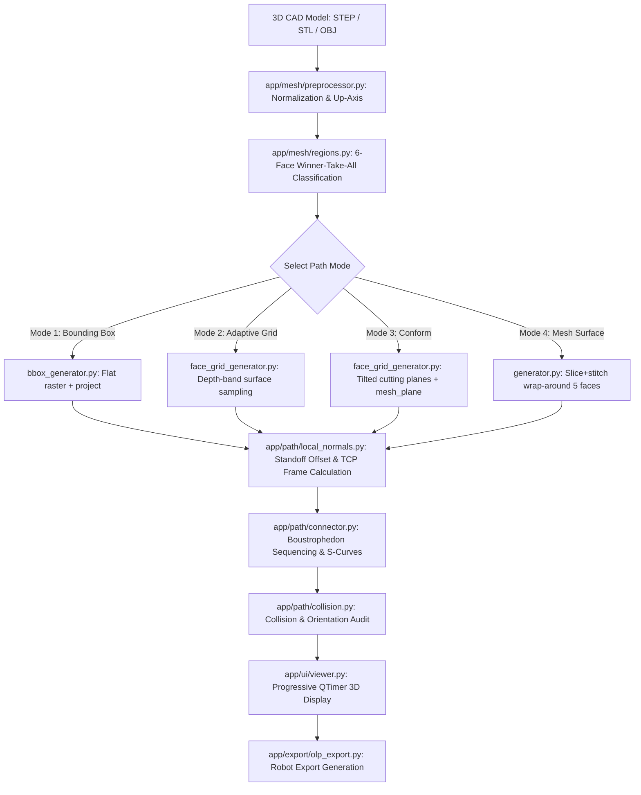

# SmartGrid OLP — Agent Handoff Document

> **Authoritative Target Branch**: `feature/review-olp`  
> **Last Clean Commit**: `950c81e` (`chore(mesh-flow): pre-fix backup — per-component scan frame, NN pass reorder, significant-chain filter`)  
> **Uncommitted Changes**: `app/meshflow/core_generator.py`, `app/meshflow/lane_planner.py`, `app/meshflow/region_manager.py`, `app/ui/ribbon.py`, `app/main_window.py`, `app/path/stitcher.py`, `tests/test_mesh_flow_selection.py` — 5 Mesh Flow coverage fixes (see §2 below)  
> **Repository Root**: [SmartGrid](file:///C:/Users/sakee/Desktop/projects/SmartGrid)  
> **Application Entry Point**: [main.py](file:///C:/Users/sakee/Desktop/projects/SmartGrid/main.py) (`python main.py`)  
> **Execution Environment**: Windows, Python 3.12.10, PySide6, PyVista + pyvistaqt, Trimesh, NumPy, SciPy (100% Offline)

---

## 1. Project Purpose & OLP Objectives

**SmartGrid** is a desktop application engineered for automated robotic Offline Programming (OLP) toolpath generation, specifically targeting automotive spray-painting processes (such as car bumpers, hoods, fenders, and side panels for automotive OEMs, e.g., Stellantis / Jeep paint shop operations).

### The Industrial Problem
Traditional robotic painting in automotive manufacturing requires offline programming engineers (using tools like ABB RobotStudio, Fanuc ROBOGUIDE, or Dürr 3D-Onsite) to manually teach or click dozens of waypoints across complex doubly-curved CAD surfaces. This process is time-consuming, prone to human inconsistency, and difficult to adapt across vehicle variants.

### SmartGrid's OLP Solution
SmartGrid ingests unmeshed or meshed 3D CAD geometries (STEP, IGES, STL, OBJ) up to 150MB–500MB, normalizes coordinates, auto-segments surfaces into canonical bounding box faces, and computes collision-free, uniform-pitch boustrophedon spray trajectories with calibrated standoff distances and outward tool orientations (TCP normal + travel tangent frames).

### Current Development Focus: `feature/review-olp`
Following an industry review with OLP domain experts (Mr. Jackson E and Mr. Vikram from automotive paint engineering; see [meeting transcript.txt](file:///C:/Users/sakee/Desktop/projects/SmartGrid/olp%20review%20details/meeting%20transcript.txt)), development pivoted from experimental academic surface fitting to strict automotive production standards:
1. **Mesh Surface Trajectory Overhaul**: Replaced non-conforming geodesic contours with surface-following slice-and-stitch boustrophedon passes.
2. **Jig / Holder Face Workflow**: Recognizing that car bodies are held by a skid jig on one side (e.g., `BOTTOM`), selecting 1 blocked face automatically generates an unbroken continuous path across all 5 exposed adjacent faces (`FRONT`, `REAR`, `LEFT`, `RIGHT`, `TOP`).
3. **Even Pitch Geometry**: Eliminated uneven edge striping by enforcing exact integer pass divisions across the bounding span ($n = \max(1, 	ext{round}(	ext{span} / 	ext{spray\_width}))$).
4. **Canonical Axis Alignment**: Fixed spray-plane distortion on curved geometries by anchoring depth and boundary filters to canonical bounding box axes rather than noisy local surface normals.
5. **Industrial Robot Formats**: Transitioning from generic CSV/JSON to direct native robot controllers (ABB RAPID `.mod`, Fanuc Karel/TP `.LS`, and Dürr EcoScreen `.tid`/`.tip`).

---

## 2. Current Verified Implementation State

The repository is checked out on branch `feature/review-olp` at commit `196fad9`. Relative to its divergence point (`91ac69d` on `feature/smartgrid-noether-boundary-spray`), exactly 7 files have been modified across 21 commits:

```
 .gitignore                      |   1 +
 app/main_window.py              |  97 ++++++++++++++---
 app/path/face_grid_generator.py | 232 ++++++++++++++++++++++------------------
 app/path/generator.py           | 212 +++++++++++++++++++++++++++---------
 app/path/local_normals.py       |   7 +-
 app/path/slicer.py              |  10 +-
 app/ui/ribbon.py                |  39 ++++++-
 7 files changed, 420 insertions(+), 178 deletions(-)
```

### Verified File-by-File Changes:
1. [.gitignore](file:///C:/Users/sakee/Desktop/projects/SmartGrid/.gitignore) (`be24e11`):
   - Ignores `olp review details/` across all branches to keep proprietary OEM CAD files and robot reference trajectories out of version control.
2. [app/path/slicer.py](file:///C:/Users/sakee/Desktop/projects/SmartGrid/app/path/slicer.py) (`4f27b67`):
   - Replaced fixed `0.85 * spray_width` heuristic with the **even pitch formula** in [compute_slice_planes](file:///C:/Users/sakee/Desktop/projects/SmartGrid/app/path/slicer.py#L70-L85). Guarantees equal spacing and centered placement without remainder gaps.
3. [app/path/local_normals.py](file:///C:/Users/sakee/Desktop/projects/SmartGrid/app/path/local_normals.py) (`915ec96`):
   - Guarded Trimesh BVH `on_surface` queries against off-by-one errors and out-of-bounds triangle IDs on exact-surface vertices by catching `(IndexError, ValueError)`, falling back to a `1e-3` tie-breaking jitter, and clamping triangle IDs with `.clip(0, len(mesh.faces) - 1)`.
4. [app/ui/ribbon.py](file:///C:/Users/sakee/Desktop/projects/SmartGrid/app/ui/ribbon.py) (`1bae529`, `2e7df7c`, `aed6890`):
   - Added `path_mode_changed` signal.
   - Added [set_direction(direction, lock=True)](file:///C:/Users/sakee/Desktop/projects/SmartGrid/app/ui/ribbon.py#L841-L855) to lock and grey out the non-applicable direction radio button in Mesh Surface mode.
   - Added [_on_standoff_custom_toggled](file:///C:/Users/sakee/Desktop/projects/SmartGrid/app/ui/ribbon.py#L724-L740) expanding the spinbox range to `0.0 - 9999.0` when Custom is checked, preventing robot profile clamps from overriding user inputs.
5. [app/main_window.py](file:///C:/Users/sakee/Desktop/projects/SmartGrid/app/main_window.py) (`4efcfd7`, `4f27b67`, `b3a059e`, `b8b1e8f`, `5fde140`):
   - Added [_auto_set_direction](file:///C:/Users/sakee/Desktop/projects/SmartGrid/app/main_window.py#L946-L957) locking Mesh Surface mode to `vertical` on side panels (`FRONT`, `REAR`, `LEFT`, `RIGHT`) and `horizontal` on top/bottom panels (`TOP`, `BOTTOM`).
   - Forced `robot_profile=None` in [_generate_mesh_paths](file:///C:/Users/sakee/Desktop/projects/SmartGrid/app/main_window.py#L1245-L1265) ensuring Mesh Surface always routes to slice+stitch, never geodesic.
   - Added progressive pass-by-pass trajectory display via a 50ms [QTimer](file:///C:/Users/sakee/Desktop/projects/SmartGrid/app/main_window.py#L1268-L1335) (`_prog_tick`), resolving UI freeze complaints.
   - Fixed connection standoff indexing in [_offset_route_by_standoff](file:///C:/Users/sakee/Desktop/projects/SmartGrid/app/main_window.py#L315-L321).
   - Added CLI file argument support to `main.py` allowing automated script execution (`python main.py <file> <up_axis>`).
6. [app/path/generator.py](file:///C:/Users/sakee/Desktop/projects/SmartGrid/app/path/generator.py) (`91e45ed`, `4efcfd7`, `4f27b67`, `77adcf0`):
   - Replaced Conform delegation with full slice+stitch pipeline: [_build_planes_combined](file:///C:/Users/sakee/Desktop/projects/SmartGrid/app/path/generator.py#L61-L100) and [generate_route](file:///C:/Users/sakee/Desktop/projects/SmartGrid/app/path/generator.py#L103-L175).
   - Implemented `visible_count` alternating boustrophedon logic: `is_fwd = (visible_count % 2 == 0)`, preventing skipped planes from causing double-back sweeps.
   - Surface passes are simplified with Ramer-Douglas-Peucker ([rdp_simplify](file:///C:/Users/sakee/Desktop/projects/SmartGrid/app/path/generator.py#L145), $\epsilon = 0.5	ext{ mm}$) and resampled along arc length.
7. [app/path/face_grid_generator.py](file:///C:/Users/sakee/Desktop/projects/SmartGrid/app/path/face_grid_generator.py) (`59303c3`, `90cbebf`, `4ad6264`, `f697288`, `b5e0ebd`, `f464f38`, `2ff7393`, `379bc27`, `196fad9`):
   - [_get_basis_faces](file:///C:/Users/sakee/Desktop/projects/SmartGrid/app/path/face_grid_generator.py#L83-L102): Replaced noisy hemisphere filter with strict projection threshold (`proj > 0.5`, fallback to `0.0`), preventing edge curvature from tilting the mean surface normal $\mathbf{ar{n}}$.
   - [generate_conform_route](file:///C:/Users/sakee/Desktop/projects/SmartGrid/app/path/face_grid_generator.py#L305-L405): Restored main-branch surface-following behavior (tilted-basis cutting planes, Trimesh mesh-plane intersection, uniform $\mathbf{ar{n}}$ standoff offset, sequential connection ordering). Segment filtering now uses canonical axis: `face_normals[:, face_axis] * face_sign > 0.1`.
   - [generate_adaptive_grid_route](file:///C:/Users/sakee/Desktop/projects/SmartGrid/app/path/face_grid_generator.py#L425-L545): Removed `_clip_inside` which was pushing standoff points back onto the mesh and desynchronizing generated paths from visible grid dots. Grid boundary uses canonical axis for named regions (`face_normals[:, face_axis] * face_sign > 0.0`).
   - [get_face_grid_plane_corners](file:///C:/Users/sakee/Desktop/projects/SmartGrid/app/path/face_grid_generator.py#L560-L615): Produces flat canonical quad corners anchored to the outer mesh depth along canonical axis, eliminating spray-plane tilt behind the object.

---

## 3. Architecture & Important Module Paths

SmartGrid follows a decoupled MVC architecture. All path generation modules operate in purely algorithmic geometry space without GUI dependencies:

```
app/
├── main_window.py          # Central coordinator, async worker threads, timer rendering
├── robot_profile.py        # Robot specs (standoff, spray width, speed, joint limits)
├── mesh/
│   ├── loader.py           # Multi-format ingestion (STEP, IGES, STL, OBJ)
│   ├── preprocessor.py     # Centering, coordinate transforms, vertex caching
│   └── regions.py          # Bounding-box 6-face classification (TOP/BOTTOM/FRONT/REAR/LEFT/RIGHT)
├── path/
│   ├── path_model.py       # Dataclasses: PaintRoute, PaintPass, Connection, GenerationParams
│   ├── generator.py        # Mesh Surface slice+stitch generator & boustrophedon builder
│   ├── face_grid_generator.py # Face Grid, Conform route, and Adaptive Grid algorithms
│   ├── slicer.py           # Trimesh mesh-plane intersection & even pitch plane calculation
│   ├── stitcher.py         # 2D/3D segment chain stitcher into polylines
│   ├── connector.py        # Pass-to-pass air move and S-curve connector generation
│   ├── bbox_generator.py   # Flat bounding-box projection generator
│   ├── local_normals.py    # Surface normal evaluation, BVH cache, TCP orientation
│   ├── collision.py        # Ray-cast collision detection & orientation limit validator
│   └── geodesic_generator.py # Historical geodesic generator (deprecated on OLP branch)
├── ui/
│   ├── ribbon.py           # Ribbon controls: target modes, standoff, pitch, speeds
│   ├── viewer.py           # PyVista Qt 3D viewport, route actor management, normal arms
│   └── view_settings_dialog.py # Viewport theme & color configuration
└── export/
    ├── csv_export.py       # Neutral CSV trajectory exporter
    ├── json_export.py      # Neutral JSON trajectory exporter
    └── olp_export.py       # RoboDK (6/7-col), Visual Components (VC), DELMIA APT
```

---

## 4. OLP Processing Pipeline & Core Algorithms



### Key Mathematical Formulations:

#### 1. Even Pitch Formula
To ensure uniform spray overlap without irregular edge strips:
$$	ext{span} = 	ext{axis}_{\max} - 	ext{axis}_{\min}$$
$$n = \max\left(1, 	ext{round}\left(rac{	ext{span}}{	ext{spray\_width\_mm}}
ight)
ight)$$
$$	ext{step} = rac{	ext{span}}{n}$$
$$	ext{first} = 	ext{axis}_{\min} + rac{	ext{step}}{2.0}$$
$$	ext{positions}[i] = 	ext{first} + i \cdot 	ext{step}, \quad i \in [0, n-1]$$

#### 2. Surface Basis Plane Construction
For a set of forward-facing basis triangles, the coordinate frame $(\mathbf{ar{n}}, \mathbf{v}_{	ext{pass}}, \mathbf{v}_{	ext{step}})$ is derived:
$$\mathbf{ar{n}} = rac{\sum_{j \in 	ext{basis}} \mathbf{n}_j}{\left\|\sum_{j \in 	ext{basis}} \mathbf{n}_j
ight\|}$$
If horizontal: $\mathbf{v}_{	ext{pass}} = 	ext{normalize}(\mathbf{u}_{	ext{up}} 	imes \mathbf{ar{n}})$, $\mathbf{v}_{	ext{step}} = \mathbf{ar{n}} 	imes \mathbf{v}_{	ext{pass}}$.  
If vertical: $\mathbf{v}_{	ext{pass}} = 	ext{normalize}(\mathbf{v}_{	ext{step}} 	imes \mathbf{ar{n}})$, $\mathbf{v}_{	ext{step}} = 	ext{normalize}(\mathbf{u}_{	ext{up}} - (\mathbf{u}_{	ext{up}} \cdot \mathbf{ar{n}})\mathbf{ar{n}})$.

#### 3. Standoff & TCP Orientation Frame
At each waypoint $\mathbf{p}_{	ext{mesh}}$, the nominal robot TCP target is:
$$\mathbf{p}_{	ext{TCP}} = \mathbf{p}_{	ext{mesh}} + d_{	ext{standoff}} \cdot \mathbf{n}(\mathbf{p}_{	ext{mesh}})$$
The tool orientation frame $R = [\mathbf{t}_X \mid \mathbf{t}_Y \mid \mathbf{t}_Z]$ is constructed per Noether / ISO standards:
- $\mathbf{t}_Z = -\mathbf{n}$ (Tool approach vector pointing into the surface).
- $\mathbf{t}_X = 	ext{normalize}(\mathbf{v}_{	ext{travel}} - (\mathbf{v}_{	ext{travel}} \cdot \mathbf{t}_Z)\mathbf{t}_Z)$ (Tool travel vector orthogonal to normal).
- $\mathbf{t}_Y = \mathbf{t}_Z 	imes \mathbf{t}_X$ (Cross product completing the right-handed orthonormal triad).

---

## 5. Critical Constraints & Safety Rules

1. **Safety Rule: Documentation-Only Task**:
   - Never modify source code, dependency configurations, or existing tests during analysis.
   - Do not switch branches, cherry-pick commits, or mutate git history.
2. **Attribution Constraint ([feedback_no_attribution.md](file:///E:/C--Users-sakee-Desktop-projects-SmartGrid/memory/feedback_no_attribution.md))**:
   - NEVER add `Co-Authored-By:` lines to commit messages. Only `sakrish205 / krishnasaketha800@gmail.com` must appear as contributor.
3. **Reference Repo Derivation ([feedback_use_reference_repos.md](file:///E:/C--Users-sakee-Desktop-projects-SmartGrid/memory/feedback_use_reference_repos.md))**:
   - Never write path planning math from scratch. Derive algorithms from reference implementations:
     - ROS-Industrial Noether: `plane_slicer_raster_planner.cpp` (`createTransform` TCP logic).
     - Boundary-Fitting: `getSamplePoints.m`, `interpolateOrientation.m`, `detectBoundary.m`.
4. **Offline Desktop Constraint**:
   - The entire tool must remain 100% offline Python (no cloud APIs, no trial web-licensing services) to meet OEM security specifications.
5. **UI Minimalism Constraint**:
   - Do not add new buttons to the ribbon when existing controls (such as the 6 bbox face selectors) can be re-used.

---

## 6. Known Bugs, Limitations & Validation Status

| Subsystem | Verified State | Limitations / Issues |
|---|---|---|
| **Mesh Surface Mode** | Slices and stitches 5-face combined wrapping paths. Even pitch and boustrophedon active. | Verified on box, cylinder, and bumper. Very high aspect-ratio CAD parts need auto-direction override validation. |
| **Adaptive Grid Mode** | Grid extent correctly aligned; `_clip_inside` removed. Waypoints strictly match visible red dots. | Tilted basis can occasionally leave sparse corners on extreme saddle surfaces. |
| **Conform Mode** | Restored main-branch surface following; canonical axis filter prevents bleeding. | `pytest` currently has 2 failing tests in `tests/test_generator.py` because tests assume per-waypoint standoff on cylinder instead of uniform $\mathbf{ar{n}}$. |
| **Mesh Flow (beta)** | Interior-face filter, curvature-adaptive pitch, unified scan frame, Cover All toggle all implemented; 126/128 tests pass. | 2 pre-existing failures in `test_generator.py` unrelated to Mesh Flow. Changes uncommitted. |
| **OLP Exporters** | RoboDK (6/7-col), VC CSV, and DELMIA APT are operational. | Native ABB RAPID (`.mod`), Fanuc (`.LS`), and Dürr (`.tid`/`.tip`) are **NOT yet implemented**. |
| **Large File Loading** | Tested on models up to 150MB. STEP loading uses cached tessellation. | Unverified on 500MB production assemblies. Memory footprint and BVH proximity build time under heavy mesh loads need profiling. |
| **Mesh Noise / Scans** | Clean manifold CAD meshes generate flawless paths. | Raw meshes with tire marks or floating disconnected triangles generate stray passes. Needs disconnected component pre-filter. |

---

## 7. Prioritized Next Development Tasks

To prepare SmartGrid for its upcoming second industry review with Stellantis / OLP engineers, execute these tasks on `feature/review-olp`:

### Task 1: Implement ABB RAPID Exporter (`.mod`)
- **Target File**: [app/export/olp_export.py](file:///C:/Users/sakee/Desktop/projects/SmartGrid/app/export/olp_export.py)
- **Specification**: Ingest `PaintRoute` list, convert orientation matrix $R$ to unit quaternion $[q_1, q_2, q_3, q_4]$ ($[w, x, y, z]$), and format as:
  ```rapid
  CONST robtarget p10:=[[X,Y,Z],[q1,q2,q3,q4],[0,0,0,0],[9E9,9E9,9E9,9E9,9E9,9E9]];
  PaintL p10, v1000, z10, tPaintGun;
  ```
- **Reference**: [olp review details/Exercise_2.mod](file:///C:/Users/sakee/Desktop/projects/SmartGrid/olp%20review%20details/Exercise_2.mod).

### Task 2: Implement Fanuc TP / Karel Exporter (`.LS`)
- **Target File**: [app/export/olp_export.py](file:///C:/Users/sakee/Desktop/projects/SmartGrid/app/export/olp_export.py)
- **Specification**: Convert orientation matrix to Euler angles ($W, P, R$ in degrees), emit ASCII Fanuc format:
  ```fanuc
  P[1]{
     GP1:
      UF : 1, UT : 1,
      X =  1000.00  mm, Y =   200.00  mm, Z =   500.00  mm,
      W =     0.00 deg, P =   -90.00 deg, R =     0.00 deg
  };
  1: L P[1] 1500mm/sec FINE ;
  ```
- **Reference**: [olp review details/Fanuc_Ref/S1_100.LS](file:///C:/Users/sakee/Desktop/projects/SmartGrid/olp%20review%20details/Fanuc_Ref/S1_100.LS).

### Task 3: Implement Dürr EcoScreen Exporter (`.tid` / `.tip`)
- **Target File**: [app/export/olp_export.py](file:///C:/Users/sakee/Desktop/projects/SmartGrid/app/export/olp_export.py)
- **Specification**: Emit Dürr motion program `.tid` and process points `.tip` following the X-step / Z-sweep conventions.
- **Reference**: [olp review details/Durr_Ref/B05.tt/Aleta_Ptras.tid](file:///C:/Users/sakee/Desktop/projects/SmartGrid/olp%20review%20details/Durr_Ref/B05.tt/Aleta_Ptras.tid).

### Task 4: Reconcile `tests/test_generator.py`
- Update `test_conform_normals_and_tangents_stored` and `test_standoff_within_tolerance_on_cylinder` to test on-demand viewer normal derivation and document the mathematical rationale for uniform $\mathbf{ar{n}}$ standoff.

### Task 5: CAD 3D Path Export
- Add an export option for 3D polyline curves embedded directly in STEP/IGES format as requested by Jackson E during the review meeting.

### Task 6: Stray Geometry Pre-Filter
- Add a Trimesh preprocessor stage in [app/mesh/preprocessor.py](file:///C:/Users/sakee/Desktop/projects/SmartGrid/app/mesh/preprocessor.py) to discard disconnected surface components whose total surface area is $< 1\%$ of the main body (eliminating tire marks and floating scan artifacts).

---

## 8. Instructions for Next Agent Session

1. **Verify You Are On `feature/review-olp`**: Run `git status` read-only. Do NOT switch branches.
2. **Review Ground Truth**:
   - Read this document ([AGENT_HANDOFF.md](file:///C:/Users/sakee/Desktop/projects/SmartGrid/AGENT_HANDOFF.md)).
   - Read [DECISIONS_AND_RULES.md](file:///C:/Users/sakee/Desktop/projects/SmartGrid/DECISIONS_AND_RULES.md) for rationale on rejected designs.
   - Read [OPEN_QUESTIONS.md](file:///C:/Users/sakee/Desktop/projects/SmartGrid/OPEN_QUESTIONS.md) for known unknowns.
3. **Commit Rule**: Always omit `Co-Authored-By` trailers from commit messages.
4. **Reference Math**: Derive exporter logic directly from files in [olp review details/](file:///C:/Users/sakee/Desktop/projects/SmartGrid/olp%20review%20details/).
