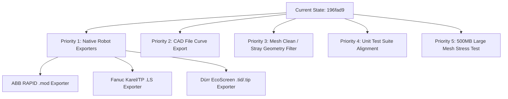

# SmartGrid OLP — Where We Left Off, Pending Work & OLP Wording

> **Target Branch**: `feature/review-olp`  
> **Repository Root**: [SmartGrid](file:///C:/Users/sakee/Desktop/projects/SmartGrid)  
> **Last Clean Commit**: `950c81e` (`chore(mesh-flow): pre-fix backup — per-component scan frame, NN pass reorder, significant-chain filter`)  
> **Uncommitted Changes**: 5 Mesh Flow coverage fixes + stitcher StopIteration fix (see §1)  
> **Last Session**: `c16940a2-5581-4755-9cb5-0c588ec179ef` (October 28, 2026)

---

## 1. Where We Left Off at the Very End

### The Exact Final State — Session `c16940a2` (2026-10-28)

Five Mesh Flow visual/crash issues were diagnosed and fixed. **All changes are uncommitted.** Tests: 126 pass, 2 pre-existing failures in `test_generator.py` (unrelated to Mesh Flow).

| # | Issue | Root Cause | Fix | Files |
|---|---|---|---|---|
| 1 | Interior cavity faces painted | `spray_normal` computed from all region faces including interior faces, which contaminated/flipped the mean → hemisphere filter inverted | Compute `spray_normal` from **largest component only**; threshold `> −0.5` (removes >120° faces, keeps ~90° edge faces) | `core_generator.py` |
| 2 | Missing top-center on curved humps | Uniform lane pitch didn't adapt to surface curvature → planes too sparse on rounded peaks | Curvature-adaptive pitch: `pitch(s) = base_pitch × |s_hat × n(s)|`; F12 floor `n_min = max(1, floor(span/pitch)+1)` | `lane_planner.py`, `core_generator.py` |
| 3 | Angled/inconsistent passes across panels | Per-component scan frames caused angle drift between adjacent panels | All components share **largest component's** `d_hat`/`s_hat` frame | `core_generator.py` |
| 4 | Small surface patches dropped (gap in coverage) | 2% area + 10% chain-length noise filters too aggressive for simple parts | **Cover All Regions** checkbox bypasses both filters | `region_manager.py`, `core_generator.py`, `ribbon.py`, `main_window.py`, `test_mesh_flow_selection.py` |
| 5 | `StopIteration` crash on generation | Near-degenerate plane intersection → all segments quantize to zero-length (a==b) → `adj` dict empty → `next(iter(adj))` raises | Early `return []` guard when `adj` is empty | `stitcher.py` |

### Previous Final State (Session `00a5930f`, Oct 14–15, 2026)
The session before this one ended after resolving a series of geometric distortion bugs on curved CAD models.

### The Immediate Problem Under Investigation
The user loaded a second, more complex CAD model into SmartGrid to test the newly implemented Mesh Surface, Conform, and Adaptive Grid algorithms. When selecting the **`LEFT`** face (highlighted by the yellow bounding-box face plane):
1. The **red plane** (the robot spray plane at standoff depth) and the **red adaptive grid lines** were projecting **behind the object** or onto the top/opposite side of the car body instead of staying on the left side with the yellow selection plane.
2. The user uploaded screenshots showing the visual error:
   - `images/2.png` & `images/3.png`: Tilted normal plane on the curved body.
   - `images/4.png`: Spray plane landing behind the CAD part when selecting `LEFT`.
   - `images/5.png`: Red adaptive grid rectangle appearing on the back/top surface.

### Exact User Wording in the Final Session:
- *"its ok for this test model but for different model see issue (i can see normal plane is not on side of the model same issue in adaptive first fix for conform mode"*
- *"when selected left face the yellow side but why the red plane behibnd the object"*
- *"the red and plane should not be other side of the body it should be same side of yellow plane"*
- *"i need working still the notmal plane no on same side"*

### The Technical Root Cause
The algorithms in [app/path/face_grid_generator.py](file:///C:/Users/sakee/Desktop/projects/SmartGrid/app/path/face_grid_generator.py) were computing the surface normal basis $\mathbf{\bar{n}}$ using a broad hemisphere filter (`mesh.face_normals @ mean_n >= 0.0`). On a curved automotive fender or wrap-around bumper, the left panel curves toward the front and top, so the average normal $\mathbf{\bar{n}}$ leaned toward the back ($[-0.9, 0.2, 0.38]$). This tilted normal caused:
- Adjacent back-facing and top-facing triangles to pass the filter.
- Spray plane corner formulas `centre ± dp*pass_vec ± ds*step_vec` to project corners onto the opposite side.
- Adaptive grid `fwd_face_ids` in line 449 to span across to the rear of the vehicle.

### The Final Pushed Fixes:
Claude pushed four sequential commits to `feature/review-olp`:
1. `b5e0ebd`: `fix(basis): prefer well-aligned faces for mean_n computation` (strict threshold `proj > 0.5` within 60° of canonical axis).
2. `f464f38`: `fix(conform): use canonical face-axis filter for segment selection` (`face_normals[:, face_axis] * face_sign > 0.1`).
3. `2ff7393` & `379bc27`: `fix(plane-viz): anchor spray-plane depth on canonical axis` and `use flat canonical corners for named regions` (guaranteeing the spray plane quad is coplanar and parallel to the yellow selection bbox face).
4. `196fad9` (**HEAD**): `fix(adaptive): use canonical axis for fwd_face_ids hemisphere`:
   ```python
   _fmap_adp = _resolve_face_map(up_axis)
   if region in _fmap_adp:
       _fa_adp, _fs_adp = _fmap_adp[region]
       fwd_face_ids = np.where(mesh.face_normals[:, _fa_adp] * _fs_adp > 0.0)[0]
   else:
       fwd_face_ids = np.where(mesh.face_normals @ mean_n >= 0.0)[0]
   ```

### The Exact Last Words of the Assistant:
> *"Pushed `196fad9`. The red rectangle was the adaptive grid lines, not the spray plane quad. `fwd_face_ids` (line 449) used the same tilted-mean_n hemisphere filter — with mean_n leaning toward the back, top/back faces passed the filter, the grid extent covered the wrong area, and the red lines traced a rectangle on the back surface.*  
> *Now all three places that used `@ mean_n >= 0.0` hemisphere filtering have been switched to the canonical axis for named regions:*  
> *- `f464f38` — conform segment filter*  
> *- `379bc27` — spray plane visualization corners*  
> *- `196fad9` — adaptive grid `fwd_face_ids`*  
> *Pull and test on the second model. The red adaptive grid and the spray plane should both appear on the same side as the yellow selection plane."*

---

## 2. Immediate Next Step & Pending Work

### Immediate Pending Step (Step 0):
**Commit the 5 Mesh Flow fixes** — all changes are staged-ready in the working tree. Then visually verify on Part1.STL: run `python main.py`, select Mesh Flow, check that:
- Top-center coverage is present (adaptive pitch working)
- Passes are parallel across all panels (unified scan frame)
- No interior/underside faces are painted (outward filter)
- Cover All toggle produces denser coverage on simple parts
- No `StopIteration` crash on any model

---

### Pending Work Packages on `feature/review-olp`:



### 1. Native Robot Controller Exporters (High Priority)
- **Status**: **NOT IMPLEMENTED YET**. (Current [olp_export.py](file:///C:/Users/sakee/Desktop/projects/SmartGrid/app/export/olp_export.py) only supports RoboDK CSV, Visual Components CSV, and DELMIA APT).
- **Deliverable**: Direct file export matching OEM software:
  1. **ABB RAPID (`.mod`)**:
     - Procedure declaration `MODULE M1 ... PROC mvPath() ... ENDPROC ... ENDMODULE`.
     - Waypoint targets: `CONST robtarget p10:=[[X, Y, Z], [q1, q2, q3, q4], [0, 0, 0, 0], [9E9, 9E9, 9E9, 9E9, 9E9, 9E9]];`
     - Paint moves: `PaintL p10, v1000, z10, tPaintGun;`
     - Reference: [Exercise_2.mod](file:///C:/Users/sakee/Desktop/projects/SmartGrid/olp%20review%20details/Exercise_2.mod).
  2. **Fanuc Karel / TP (`.LS`)**:
     - Position block:
       ```fanuc
       P[1]{
          GP1:
           UF : 1, UT : 1,
           X = 1000.00 mm, Y = 200.00 mm, Z = 500.00 mm,
           W = 0.00 deg, P = -90.00 deg, R = 0.00 deg
       };
       ```
     - Motion block: `1: L P[1] 1500mm/sec FINE ;`
     - Reference: [Fanuc_Ref/S1_100.LS](file:///C:/Users/sakee/Desktop/projects/SmartGrid/olp%20review%20details/Fanuc_Ref/S1_100.LS).
  3. **Dürr EcoScreen / 3D-Onsite (`.tid` & `.tip`)**:
     - Format: X-step, Z-sweep motion records with spray process parameter blocks.
     - Reference: [Durr_Ref/B05.tt/Aleta_Ptras.tid](file:///C:/Users/sakee/Desktop/projects/SmartGrid/olp%20review%20details/Durr_Ref/B05.tt/Aleta_Ptras.tid).

### 2. CAD File Export of Toolpath Curves (Medium Priority)
- **Status**: **PENDING**.
- **Requirement**: Vikram and Jackson requested exporting 3D path lines inside CAD format (STEP or IGES wireframe) so that operators lacking OLP software can import the curves into native CAD/CAM systems.
- **Implementation**: Add an export function using `pythonocc-core` or Trimesh to bundle trajectory polylines as 3D curves into a companion `.step` file.

### 3. Raw Mesh Cleaning & Disconnected Component Pre-Filter
- **Status**: **PENDING**.
- **Requirement**: Scanned automotive bumper meshes (like `Mazda MX5.wrl`) contain ground shadows, tire tracks, and floating disconnected triangles that trigger the bounding-box classifier to inflate part extents.
- **Implementation**: In [app/mesh/preprocessor.py](file:///C:/Users/sakee/Desktop/projects/SmartGrid/app/mesh/preprocessor.py), perform connected-component analysis:
  `components = mesh.split(only_watertight=False)`
  Discard components whose surface area is $< 2\%$ of the dominant body.

### 4. Unit Test Reconciliation
- **Status**: **PENDING**.
- **Requirement**: In `tests/test_generator.py`, two tests fail (`test_conform_normals_and_tangents_stored` and `test_standoff_within_tolerance_on_cylinder`).
- **Fix**: Update the tests to test on-demand viewer normals (since normals BVH was moved off main thread in `b95dd71`) and document that uniform $\mathbf{\bar{n}}$ standoff is an intentional design rule to prevent scatter on curved geometry.

### 5. Large File Capacity Validation (500MB Target)
- **Status**: **PENDING**.
- **Requirement**: Vikram warned that OEM vehicle CAD files reach 500MB. Need to benchmark memory usage and confirm that BVH spatial indexing doesn't exceed 4GB RAM or freeze the UI during pre-processing.

---

## 3. Industrial Wording, Terminology & Exact Phrasing

Preserving the precise domain vocabulary used by the client and domain experts ensures seamless pair programming and requirements adherence:

### A. The User's Phrasing & Rules:
- **"Straight line that follows curvature"**:
  Does *not* mean a flat 2D projection in empty space. Means a 3D surface-following intersection line that goes directly from edge to edge without erratic lateral zigzags, while adhering to the part's cross-sectional contour.
- **"The missing face / blocked face / jig face"**:
  The face where the automotive body is clamped on the skid carrier/fixture (typically `BOTTOM`). The user selects this 1 face to indicate where the robot *cannot* paint.
- **"5 sides of the selected face only"**:
  When the jig face is selected (e.g. `BOTTOM`), SmartGrid must automatically plan a single continuous, non-overlapping trajectory across the 5 exposed adjacent faces (`FRONT`, `REAR`, `LEFT`, `RIGHT`, `TOP`).
- **"Single start and single end, no intersect, no overlap, not inside the mesh"**:
  Production spray paths must be a continuous single boustrophedon chain. Connectors must be smooth air-moves outside the mesh at standoff depth.
- **"Custom standoff vs Robot default"**:
  When "Custom" checkbox is unchecked, the spinbox is locked to the robot profile's calibrated optimal distance (e.g. 150mm for EcoRP E043i). When checked, user can type any custom value (0–9999mm) without profile clamping.
- **"Yellow plane vs Red plane"**:
  - **Yellow plane**: The bounding box face selection highlight. Placed at bounding box extent. Always correct.
  - **Red plane / Normal plane**: The robot spray plane at standoff depth. Must always sit on the same side as the yellow selection plane.

### B. OLP Reviewers' Terminology (Jackson E & Vikram):
- **"Tool Center Point (TCP) & Standoff"**:
  *"In painting, the tool won't directly touch the path... tool center point will be there... 100 mm, 200 mm standard thing... it won't touch the body."*
- **"Perpendicular Tool Orientation (90-degree normal)"**:
  *"Whatever points which you are selecting, the tool orientation needs to be perpendicular to the part."*
- **"Corner change orientation"**:
  *"Where the corner change, there the tool will be in orientation... face is downside, not on the side. The area which we need to cover is the bottom."*
- **"Robot programming formats"**:
  *"Format of the robot programming... ABB, Dura, or Fanuc... Vik if you have any programs, you can send that to them so that they can make in that way... robtarget, quaternion values."*
- **"CAD file capacity"**:
  *"CAD import... capacity how much MB it is... sometimes our CADs are little big, go around 500 MB also sometimes... it should not load slowly."*
- **"Export as a CAD"**:
  *"At least we can take this as a CAD. We can import in the software. From that we can able to make the OLP program."*
- **"100% Offline Python"**:
  *"Totally constructed with offline and Python libraries... first time installed then not required to connect internet... should not avoid our security things."*
